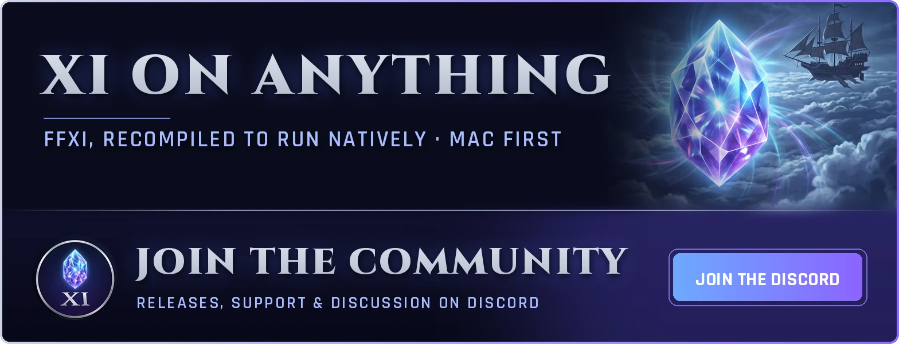
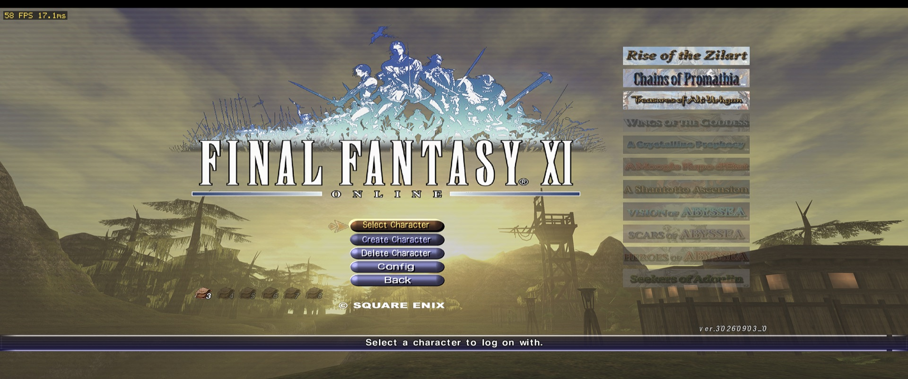
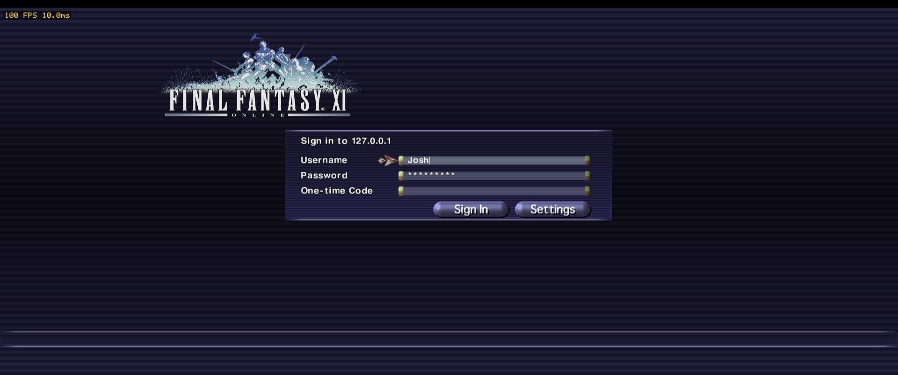
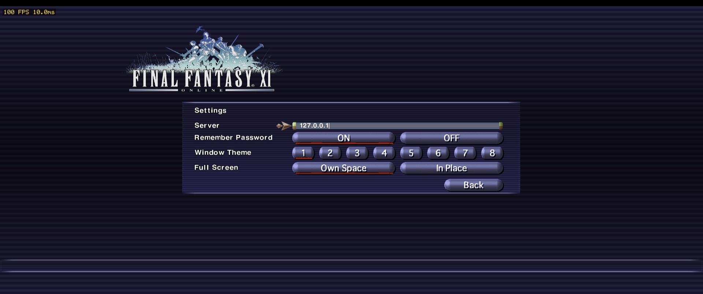
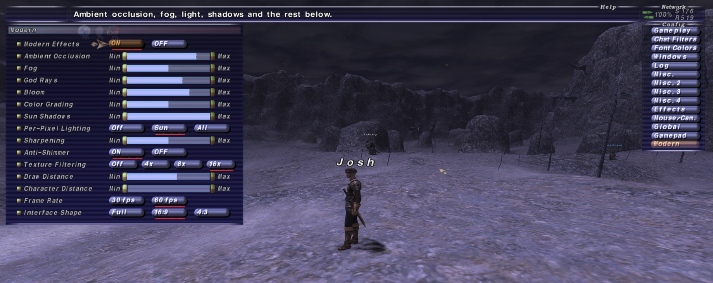
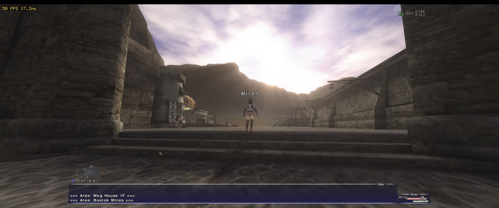
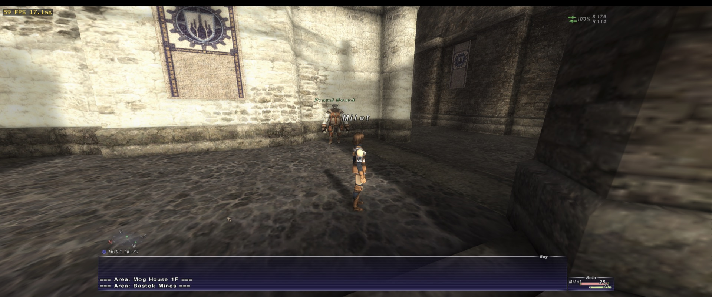
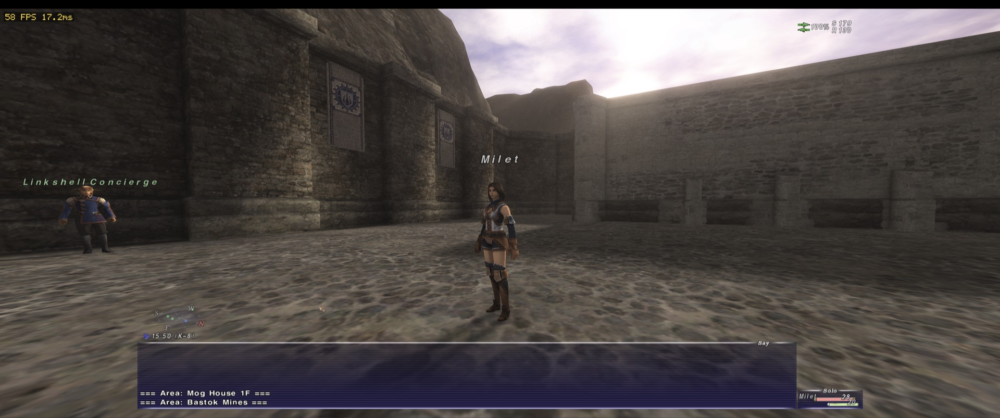
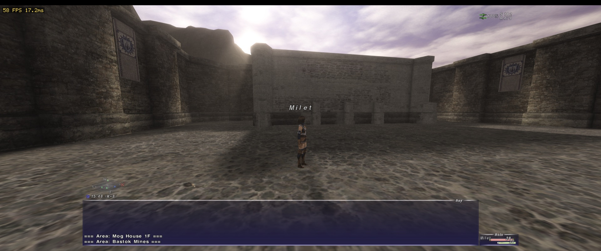

<a href="https://discord.gg/4vUKPgyvEp"></a>

# XI on Anything

**FINAL FANTASY XI, running natively on Mac, Steam Deck, Linux, iPhone and more.** It runs the
game's own original code, not a remake or an emulator, rebuilt to run directly on each device with
no Wine, Rosetta or Proton in between.

> [!IMPORTANT]
> **This is not a new or rewritten game client.** Some recent projects rebuild FINAL FANTASY XI's
> client from scratch, often with AI, and imitate how the game looks and plays. XI on Anything is
> Square Enix's own client: the exact code from your install, translated to run on new hardware.

You bring your own copy of the game. The launcher turns it into a version built for your machine,
right on your machine, then keeps it up to date. Nothing from Square Enix is ever stored or shared
here.

### Start playing

**Windows PC:** download and run the
[launcher installer](https://github.com/rubymatrix/xi-on-anything/releases/latest/download/XI-on-Anything-windows-x64-setup.exe)
from the [latest release](https://github.com/rubymatrix/xi-on-anything/releases/latest).

**Mac (Apple silicon, M1 or later), Steam Deck or Linux PC (x86_64):** open Terminal and paste:

```bash
curl -fsSL https://raw.githubusercontent.com/rubymatrix/xi-on-anything/main/install.sh | bash
```

That installs the [launcher](docs/install.md#the-launcher-players), which does the rest. You don't
need to build anything in this repo to play. On other devices, find yours under
[Platforms](#platforms) below.

Questions or stuck? [Join the Discord](https://discord.gg/4vUKPgyvEp).

## Platforms

Find your device, then follow its guide. Each guide goes from nothing to the title screen.

| Device | Status | How you get it | Guide |
| --- | --- | --- | --- |
| **Mac** (Apple silicon) | Ready | Launcher, or build it yourself | [macOS](docs/platforms/macos.md) |
| **Steam Deck** | Ready | Launcher (in Desktop Mode), then play from Game Mode | [Steam Deck](docs/platforms/steam-deck.md) |
| **Linux PC** (x86_64) | Ready | Launcher, or build it yourself | [Linux](docs/platforms/linux.md) |
| **iPhone / iPad** | Ready | Build on a Mac, install with a free Apple account | [iPhone and iPad](docs/platforms/ios.md) |
| **Windows PC** (x64) | Ready | Launcher installer, or build it yourself (Visual Studio or llvm-mingw) | [Windows](docs/platforms/windows.md) |
| **Web browser** | Experimental, host it yourself | Build and host it yourself | [Web browser](docs/platforms/web.md) |
| **Xbox One / Series** | Experimental | Developer Mode, sideloaded | [Xbox](docs/platforms/xbox-one.md) |
| **Android** (ARM64) | Experimental, tested on a Pixel Fold | Debug APK | [Android](docs/android.md) |
| **PS4** | Experimental | Jailbroken console, fake PKG (branch `port/ps4`) | [PS4](docs/platforms/ps4.md) |
| **Nintendo Switch** | Experimental | Homebrew `.nro` for a console running Atmosphère | [Switch](docs/platforms/switch.md) |

Every device needs two things: your own copy of the game (a `FINAL FANTASY XI` folder from a
[supported version](docs/new-client-version.md#supported-builds), with `FFXiMain.dll` and `ROM` in
it), and a [LandSandBoat](https://github.com/LandSandBoat/server) server to play on. What all
platforms share is in [docs/platforms](docs/platforms/README.md).

## Graphics options

All of these are in game under **Config > Advanced**. Pick an Overall Quality of Low, Medium or
Max, or tune each row yourself.

- **Display:** window mode, resolution, UI scale, interface shape (full width, 16:9 or 4:3) and
  background resolution up to 8192
- **Frame rate:** 30, 60, 120 or 144 fps, or uncapped, with an FPS counter
- **Graphics:** the Original renderer or Deferred (lit per pixel), anti-aliasing, texture filtering
  up to 16x and sharpening
- **Upscaling:** MetalFX on Mac, FSR on Windows and Linux, with a render scale
- **Color:** HDR, tone mapping, exposure, color grading, saturation and contrast
- **World detail:** longer draw distance and character distance
- **Shadows:** soft sun and moon shadows, shadows from lamps, and lamps filling in shadows at night
- **Lighting:** every lamp lit per pixel, night brightness and tint, bounce light, ambient
  occlusion, and highlights on wet surfaces
- **Atmosphere:** modern fog with ground fog, drifting mist and lamp halos; sun shafts; bloom;
  depth of field
- **Water:** modern water with reflections, sun highlights and foam
- **Interface:** nameplate shape and size, hiding Trust, Mounts and Geomancy menus, and addon scale
- **Widescreen and ultrawide:** the 3D view widens with the window instead of stretching, and
  nameplates keep their shape

Some effects are not on every platform or game version yet (several need Metal or Vulkan).

Every setting, in game and out, is in the [options catalog](docs/options.md).

### Other features

- **Your server's custom files** load on top of your install without changing it
  ([DAT overlays](docs/running.md#dat-overlays---dats)).
- **Ashita and Windower addons** run unmodified, without DLL injection
  ([in progress](docs/addons.md)).
- **Discord status** shows your character, job and zone on your profile while you play. Nothing
  extra to install.

## How it works

FINAL FANTASY XI was made for 32-bit Windows PCs. Most ways of playing it elsewhere run that
Windows code inside a translator (Wine, Rosetta, Proton) every second you play.

XI on Anything does the translating once, ahead of time. It reads the game code from your install
and rewrites it as a normal program for your device. Then it runs that program on its own
replacement for the Windows pieces the game expects: graphics, sound, controls and networking.

### For developers

The game's `FFXiMain.dll` (and `FFXi.dll`) are statically recompiled from 32-bit x86 to C on the
player's machine, from their own install. The output runs on our own platform layer: Win32,
Direct3D 8 on Metal, Vulkan, Direct3D 12 or WebGPU, audio, input and sockets.

This repo holds the recompiler, its runtime, that platform layer, and `host64`, the game host, with
its own sign-in screen drawn in the game's UI art. Sign-in takes a username, password and one-time
code, or a server launcher's token. Start with [Building](docs/building.md) and the
[repository layout](docs/layout.md).

## Screenshots

<table>
  <tr>
    <td colspan="2"></td>
  </tr>
  <tr>
    <td width="50%"></td>
    <td width="50%"></td>
  </tr>
  <tr>
    <td colspan="2"></td>
  </tr>
  <tr>
    <td width="50%"></td>
    <td width="50%"></td>
  </tr>
  <tr>
    <td width="50%"></td>
    <td width="50%"></td>
  </tr>
</table>

## Documentation

| Guide | What's in it |
| --- | --- |
| [Platform guides](docs/platforms/README.md) | Step by step setup for every device |
| [Installing](docs/install.md) | The launcher, and the one-line install from source |
| [Building](docs/building.md) | Building it yourself on Mac, Linux and Windows |
| [Running `host64`](docs/running.md) | Sign-in screen, command-line options, custom server files, environment variables |
| [Options catalog](docs/options.md) | Every setting, in game and out |
| [Addons](docs/addons.md) | Ashita and Windower addons |
| [Game versions](docs/new-client-version.md) | Which versions of the game work, and adding a new one |
| [iPhone and iPad](docs/ios.md), [Web](docs/web.md), [Xbox](xbox/README.md), [Android](docs/android.md), [Switch](docs/switch.md) | Developer notes for each port |
| [Replay scenes](tools/replay/README.md) | Recorded scenes for performance testing |
| [Repository layout](docs/layout.md) | What lives where |

## Rules

In short: this repo holds our tools, never the game. The game stays yours, on your machine.

- **No Square Enix bytes in this repo, ever.** No retail DLLs, no unpacked images, no DAT files, and
  **no generated C**. Generated code is derived from the game, so it is produced on the player's
  own machine from their own install. `.gitignore` enforces the obvious paths; the rule applies
  everywhere.
- What *is* committed: the recompiler, the runtime, the platform layer, tests, and per-build
  **metadata**: addresses and shapes only (function ranges, switch tables, tail jumps), keyed by
  the SHA-256 of the retail DLL. The supported builds are listed in
  [Client versions](docs/new-client-version.md#supported-builds).
- **LandSandBoat packet captures** are committed too, as the maintainers agreed: the replay suite's
  recordings in `tools/replay/scenes/`, so every machine and CI plays the same scenes. They are what
  a server sent, not game files.

## License

In short: our code is MIT; the game and anything built from it is not ours to license.

MIT (`LICENSE`), for this repo's own code. `third_party/` keeps its own licenses (stb: MIT or
public domain; SDL3 and nanosvg: zlib; Mbed TLS: Apache-2.0). The license does not cover FINAL FANTASY XI:
no game files or code derived from them are in this repo, and what the tools produce from your
install (`generated/`, `build/`) is derived from Square Enix's work, for your own use only.
