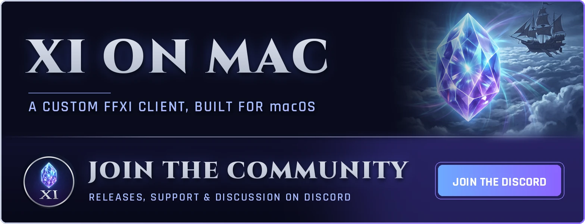

<a href="https://discord.gg/4vUKPgyvEp"></a>

> [!IMPORTANT]
> ## ▶ To play, get the [XI on Anything launcher](docs/install.md#the-launcher-players)
>
> **The launcher installs and updates everything for you.** You don't need to build this repo
> to play. Paste into Terminal:
>
> ```bash
> curl -fsSL https://raw.githubusercontent.com/rubymatrix/xi-on-anything/main/install.sh | bash
> ```
>
> Needs an Apple silicon Mac (M1 or later), a Steam Deck or an x86_64 Linux PC, and your own copy
> of FINAL FANTASY XI. Other platforms: see [Platforms](#platforms).
> This repo is the source of the recompiler and game host, for anyone who wants to build it.

FINAL FANTASY XI running natively, with no Wine, Rosetta or Proton. The game's `FFXiMain.dll`
(and `FFXi.dll`) are statically recompiled from 32-bit x86 to C on your own machine, from your own
install, and run on a platform layer of our own: Win32, Direct3D 8 on Metal, Vulkan, Direct3D 12 or WebGPU, audio, input
and sockets. This repo holds the recompiler, its runtime, that platform layer, and `host64`, the
game host, with its own sign-in screen drawn in the game's UI art.

**Works with [LandSandBoat](https://github.com/LandSandBoat/server) servers.** Sign in with a
username, password and one-time code, or a server launcher's token; pick the server in the
sign-in screen's Settings.

## Platforms

> [!TIP]
> **Find your platform, then follow its guide.** Each one goes from nothing to the title screen.

| platform | status | how you get it | guide |
| --- | --- | --- | --- |
| **macOS**, Apple silicon | ✅ Supported | Launcher (the line above), or build from source | [macOS](docs/platforms/macos.md) |
| **Steam Deck** | ✅ Supported | Launcher (the line above, in Desktop Mode), played from Game Mode | [Steam Deck](docs/platforms/steam-deck.md) |
| **Linux**, x86_64 | ✅ Supported | Launcher (the line above), or build from source | [Linux](docs/platforms/linux.md) |
| **iPhone / iPad** | ✅ Supported | Build on a Mac, install with a free Apple account | [iPhone and iPad](docs/platforms/ios.md) |
| **Windows**, x64 | ✅ Supported | Build from source (Visual Studio or llvm-mingw) | [Windows](docs/platforms/windows.md) |
| **Web browser** | 🧪 Experimental, self-hosted only | Build and host it yourself | [Web browser](docs/platforms/web.md) |
| **Xbox One / Series** | 🧪 Experimental | Developer Mode, sideloaded | [Xbox](docs/platforms/xbox-one.md) |
| **Android**, ARM64 | 🧪 Experimental (tested on a Pixel Fold) | Debug APK | [Android](docs/android.md) |
| **PS4** | 🧪 Experimental | Jailbroken console, fake PKG (branch `port/ps4`) | [PS4](docs/platforms/ps4.md) |

Every platform needs your own copy of the game (a `FINAL FANTASY XI` folder of a
[supported build](docs/new-client-version.md#supported-builds), with `FFXiMain.dll` and `ROM` in it)
and a LandSandBoat server to sign in to. What every platform has in common is in
[docs/platforms](docs/platforms/README.md).

## What's better than the original

- **A Modern page in the game's own Config menu**, next to Gameplay, Windows and the rest:
  - ambient occlusion, fog, god rays, bloom, color grading and sun shadows, each with a slider
  - per-pixel lighting (off, sun only, all lights), sharpening and anti-shimmer
  - texture filtering up to 16x, and longer draw and character distances
  - 30 or 60 fps
  - interface shape: full width, 16:9 or 4:3
  - the occlusion check: off (everything counts as seen, the fastest) or exact
- **Widescreen and ultrawide**: the 3D view widens with the window instead of stretching a 4:3
  view, the interface can stay 16:9 in the middle of an ultrawide, and nameplates keep their shape.
- **A native sign-in screen** in the game's own window themes and font, with the password kept in
  the system's password store (macOS Keychain, Windows Credential Manager, Linux Secret Service).
- **[DAT overlays](docs/running.md#dat-overlays---dats)** for a server's own DATs, without touching the install.
- **Ashita v4 and Windower 4 Lua addons**, unmodified, without DLL injection
  ([in progress](docs/addons.md)).
- **Discord Rich Presence**: your character, jobs and zone on your Discord profile while you play,
  straight to the Discord app's local socket (no SDK, nothing to install).

## Screenshots

<table>
  <tr>
    <td colspan="2"></td>
  </tr>
  <tr>
    <td width="50%"></td>
    <td width="50%"></td>
  </tr>
  <tr>
    <td colspan="2"></td>
  </tr>
  <tr>
    <td width="50%"></td>
    <td width="50%"></td>
  </tr>
  <tr>
    <td width="50%"></td>
    <td width="50%"></td>
  </tr>
</table>

## Documentation

| | |
| --- | --- |
| [Platform guides](docs/platforms/README.md) | Step by step, for every platform |
| [Installing](docs/install.md) | The launcher (macOS, Steam Deck, Linux) and the one-line source install |
| [Building](docs/building.md) | Building by hand on macOS, Linux and Windows; `Final Fantasy XI.app` and its signing |
| [Running `host64`](docs/running.md) | The sign-in screen, command-line options, DAT overlays, environment variables |
| [Options catalog](docs/options.md) | Every setting, in game and out |
| [Addons](docs/addons.md) | Ashita and Windower Lua addons |
| [Client versions](docs/new-client-version.md) | The supported builds, and adding a new one |
| [iPhone and iPad notes](docs/ios.md), [Web](docs/web.md), [Xbox](xbox/README.md), [Android](docs/android.md) | Each port's developer notes |
| [Replay scenes](tools/replay/README.md) | Recorded scenes for performance tests |
| [Repository layout](docs/layout.md) | What lives where |

## Rules

- **No Square Enix bytes in this repo, ever.** No retail DLLs, no unpacked images, no DAT files, and
  **no generated C**. Generated code is derived from the game, so it is produced on the player's
  own machine from their own install. `.gitignore` enforces the obvious paths; the rule applies
  everywhere.
- What *is* committed: the recompiler, the runtime, the platform layer, tests, and per-build
  **metadata**: addresses and shapes only (function ranges, switch tables, tail jumps), keyed by
  the SHA-256 of the retail DLL. The supported builds are listed in
  [Client versions](docs/new-client-version.md#supported-builds).
- **LandSandBoat packet captures** are committed too, as the maintainers agreed: the replay suite's
  recordings in `tools/replay/scenes/`, so every machine and CI plays the same scenes. They are what
  a server sent, not game files.

## License

MIT (`LICENSE`), for this repo's own code. `third_party/` keeps its own licenses (stb: MIT or
public domain; SDL3: zlib; Mbed TLS: Apache-2.0). The license does not cover FINAL FANTASY XI:
no game files or code derived from them are in this repo, and what the tools produce from your
install (`generated/`, `build/`) is derived from Square Enix's work, for your own use only.
