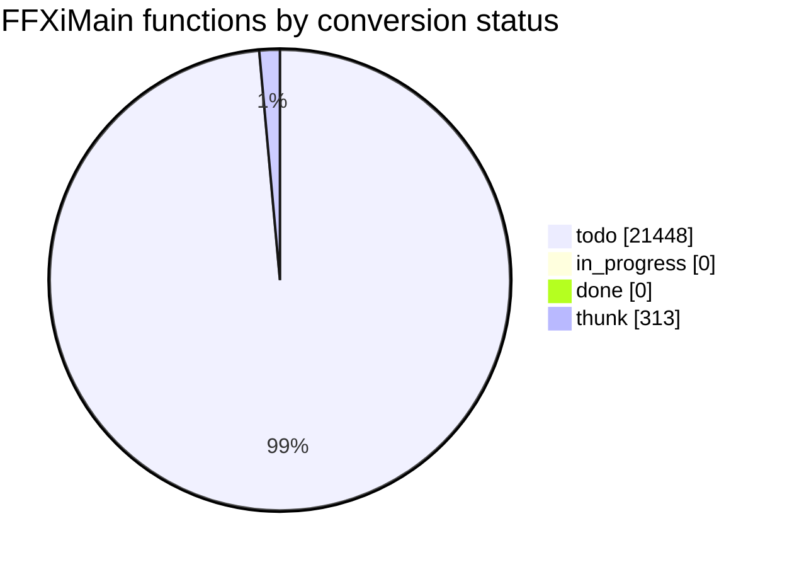

# Conversion status

<!-- Generated by tools/cow/status.py - do not edit by hand. Rerun: python tools/cow/status.py -->

- Last updated: 2026-11-02 09:51:29 UTC
- Commit: `db2a1e2` (branch `main`, working tree dirty)
- Ledger: `ledger/functions.csv` (21761 rows)

## Progress

done 0 of 21448 (0.0%)

_Thunks (313) are excluded from the denominator: they are 5-byte `jmp rel32` stubs, not conversion work._

## Status counts

## Progress by leaf_rank

`leaf_rank` 0 calls no other FFXiMain function, so conversion starts there and works up.

| leaf_rank | done | total | % |
| --- | --- | --- | --- |
| 0 | 0 | 7497 | 0.0% |
| 1 | 0 | 2738 | 0.0% |
| 2 | 0 | 1353 | 0.0% |
| 3+ | 0 | 9860 | 0.0% |
| cycle | 0 | 118 | 0.0% |

_The `cycle` row is an overlay on the rank buckets (a function in a cycle also sits in one of them), so it does not add to the total._

## Last completed functions

_None yet._

_Order is ledger order (entry address ascending); the ledger has no completion timestamp._
