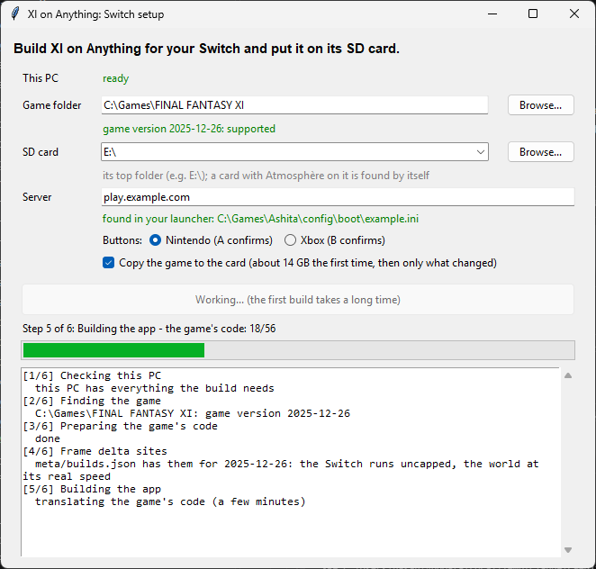

# Nintendo Switch (homebrew, experimental)

The recompiled game as a Switch homebrew app (`.nro`), built with devkitPro's libnx on your own PC from
your own game files, and copied to the console's SD card with the game beside it.

Developer notes are in [../switch.md](../switch.md).

> [!IMPORTANT]
> **Status**: experimental, playable on a console. The sign-in screen, the game in the world, battles
> and menus run on a Switch (Atmosphère), drawn with Mesa's OpenGL, with sound (music not yet
> confirmed). Shaders are kept on the card (Mesa 26, which the setup downloads), so each compiles once:
> a short hitch the first time an effect is ever seen, not every session. Not yet: the scene effects
> (Modern FX, water, sun shadows), addons, sleep and resume.

## What you need

- A Windows, Linux or macOS PC. The [Quick start](#quick-start)'s setup installs what follows when it is
  missing (on Windows: Python with winget, devkitPro with its own installer, then the packages; on Linux and
  macOS the packages, once devkitPro's pacman is in). By hand: [devkitPro](https://devkitpro.org/wiki/Getting_Started) and these
  packages: `pacman -S switch-dev switch-mesa switch-libdrm_nouveau switch-glad switch-zlib switch-libexpat`. On Windows, devkitPro's
  msys2 or your own msys2 with devkitPro's pacman repositories both work; set `DEVKITPRO` (or `XI_MSYS2`)
  if it is not in `C:\devkitPro`, `C:\msys64` or `D:\msys64`.
- Python 3.12+ with `capstone` and `pefile`.
- Your `FINAL FANTASY XI` folder and a LandSandBoat server ([README.md](README.md)).
- To run on a console: a Switch that runs homebrew (Atmosphère), launched with **full memory**: hold R
  while starting a game to open the homebrew menu over it. The album's
  homebrew menu has too little memory for the game.
- To run without a console: [Ryubing](https://git.ryujinx.app/projects/Ryubing/releases) with your own
  console's `prod.keys` (dumped with Lockpick_RCM) in its `system` folder. Its portable mode (a
  `portable` folder beside `Ryujinx.exe`) keeps its data and virtual SD card beside it. Turn on
  **Settings > Network > Enable guest Internet access**: without it Ryubing's resolver refuses every name,
  even `127.0.0.1`, and the host exits with `--server: cannot resolve`. On macOS, `build_switch.py` finds
  `Ryujinx.app` in `/Applications` or `~/Applications` and its card in `~/Library/Application Support/Ryujinx`.

## Quick start

With the SD card in the PC:

- **Windows**: double-click `setup-switch.bat` in the `switch` folder.
- **Linux, macOS**: `./switch/setup-switch.sh`.

A window opens: pick your game folder and the SD card with **Browse...** (a card with Atmosphère on it is
listed by itself, and the server is filled in from your launcher), click **Install** beside *This PC* if it
says something is missing, then **Build and install**. With options (below) or `--console`, or without a
display or tkinter, it asks in the terminal instead.



What's missing it offers to install, a yes each: Python (Windows, with winget), its `capstone` and
`pefile` (pip), devkitPro (Windows: it downloads devkitPro's installer and opens it: keep `C:\devkitPro`
and tick **Switch Development**; on Linux and macOS install [devkitPro's pacman](https://devkitpro.org/wiki/devkitPro_pacman)
first) and devkitPro's Switch packages (with its pacman; `sudo` asks for your password on Linux and macOS).

It asks for your `FINAL FANTASY XI` folder, the SD card (it finds a card with `atmosphere/` or `switch/`
on it by itself) and the server's address: the name or IP your launcher signs in to, which it offers
when it finds it near the game folder (an Ashita boot config's `--server`, VanaCore's `[server]`, a launch
script's `--server`); for a CatsEyeXI server it adds `--cexi full` to `run.args` (its own items, gear, spells
and abilities) unless `run.args` sets `--cexi` already. Then it does every step below in order: it checks the PC, identifies your game version, prepares its code,
finds its frame delta sites if this repository doesn't have them yet, builds the `.nro`, and copies the
`.nro`, the game and the settings to the card, and Sphaira for a
[home screen icon](#home-screen-icon). Then [run it](#3-run).

The options answer the questions instead, for a script or a second run:

```
python tools/setup_switch.py --game "<your FINAL FANTASY XI folder>" --sd E:\ --server <server name or IP>
```

`--layout xbox`, `--dats <folder>` and `--arg "<host options>"` are as in [step 2](#2-put-it-on-the-sd-card);
`--check` checks the PC and stops; `--no-copy-game` leaves the game on the card as it is; `--no-icon` (or
unticking **Home screen icon**) leaves Sphaira off the card. The answers are
remembered (`build/switch/setup.json`), and what each step printed is in `build/switch/setup.log`.

**Updating**: after a game update, or a pull of this repository, run it again. Each step skips what is
already done: the build compiles only what changed and the copy sends only files that differ. With only
the `.nro` new, `--no-copy-game` (or `build_switch.py deploy`, [step 3](#3-run)) is quicker.

A game version this repository doesn't know stops it at the start, with its `FFXiMain.dll`'s SHA-256: it
needs its own metadata first ([new-client-version.md](../new-client-version.md)).

## Manual steps

What `setup-switch` does, one command at a time.

### 1. Build

```
python tools/prepare.py --game "<your FINAL FANTASY XI folder>"
python tools/frame_sites.py
python tools/build_switch.py host
```

`prepare.py` identifies your game version and unpacks its code into `generated/`. `frame_sites.py` is only
needed when `meta/builds.json` has no frame delta sites for your version (no `frame_int_sites` in its entry;
a build without them logs `has no frame delta sites` at the start): it finds them and adds them to
`meta/builds.json`. With them the Switch runs uncapped with the world at its real speed; without them, at
30 fps ([Performance](#performance)). If it can't find them it says so and changes nothing: skip it.

`host` translates the game (the desktop translation, `generated/all`, shared with the PC builds) and
writes `build/switch/xi-on-anything.nro`. The first build compiles about 6 million lines of generated C
and takes a while; later builds compile only what changed. `XI_SWITCH_JOBS` (default 6) is how many
generated files compile at once; lower it if the PC runs out of memory.

### 2. Put it on the SD card

```
python tools/build_switch.py setup --sd E:\ --game "<your FINAL FANTASY XI folder>" --server <server name or IP>
```

`--sd` is the card's root: in a card reader, the console's card over USB (Hekate's USB Mass Storage), or
`--sd emu` for the emulator's virtual card. It copies:

- the `.nro` to `sdmc:/switch/xi-on-anything/`, where the homebrew menu lists it
- the game to `sdmc:/switch/xi-on-anything/SquareEnix/FINAL FANTASY XI` (and the viewer folder beside it,
  if your install has one): about 14 GB the first time. Run it again after a game update, or if a copy
  stopped part way: only files whose size or date differ are copied.
- `ffxi.reg`, and `switch.reg` over it: the Switch's defaults (a 1920x1080 window and background,
  windowed, menus at 960x540 so the UI is twice its size, readable on a TV and in handheld). What you
  change in game is saved to `settings.reg` beside them and wins over both.
- `run.args` with the options you gave: an option given replaces its line there, and every other line
  (yours, added by hand) is kept

After the first copy, a copy of the game is skipped when the game folder hasn't changed since (a file
`.xi-on-anything-copy` on the card records what was copied); `--full-check` compares every file anyway.
`build_switch.py install` takes the same options and does steps 1's `host` and 2 in one, as
`build_android.py install` does for Android.

`setup`'s options, which it writes to `run.args` (one host argument per line; edit the file on the card
to change them later; `--layout` becomes `--switch-layout` there):

| Option | What it does |
| --- | --- |
| `--server <name or IP>` | The LandSandBoat server. Without it, the sign-in screen asks. |
| `--layout nintendo\|xbox` | `nintendo` (the default): A confirms and B cancels, as everywhere on the Switch. `xbox`: by position, B (the bottom button) confirms. |
| `--fps-divisor 0\|1\|2` | Leave it out: the default is the best there is (uncapped with frame delta sites, else 30). 1 (60 fps) or 2 (30) turn the frame delta sites off: see [Performance](#performance). |
| `--dats <folder>` | A DAT overlay folder, copied to the card and passed as `--dats`. |
| `--arg "<host options>"` | Any other [host option](../running.md#options), for example `--arg "--user me"`. |

Don't put `--pass` in `run.args` unless the card stays with you: it is a plain text file. Use the sign-in
screen's **Remember password** instead: the password is kept on the card encrypted with a key only your
console has (`sdmc:/switch/xi-on-anything/data/keychain/`), so a copy of the card can't be read on a
computer or another Switch.

A line `FFXI_NAME=value` in `run.args` sets that environment variable instead of passing an argument
(there is no shell on the Switch), for example `FFXI_NET_TRACE=1` to log the network.

### 3. Run

- **Console**: hold R while starting any game, then pick **XI on Anything** in the homebrew menu
  ([Settings](#settings): **XI on Anything Settings**).
- **Emulator**: `python tools/build_switch.py run` copies the `.nro` to the emulator's card and starts it.
- **After a rebuild**, without copying the game again: `python tools/build_switch.py deploy --ip <console IP>`
  sends the new `.nro` over the network (press Y in the homebrew menu first, to receive it).

The log is `sdmc:/switch/xi-on-anything/host64.log`; `python tools/build_switch.py logs --sd <card>` prints it.

### Home screen icon

A forwarder: an icon on the HOME menu that starts the `.nro` on the card with full memory, so you don't
have to hold R over a game. It is an installed title, which only the console can install with its own
keys, so it is made on the Switch, by [Sphaira](https://github.com/ITotalJustice/sphaira) (a homebrew
menu). The setup puts Sphaira's latest release in `sdmc:/switch/sphaira/` unless the card has a Sphaira
already; by hand, copy `switch/sphaira/sphaira.nro` from its release zip there. Then, on the Switch:

1. Hold R while starting any game, and start **Sphaira** from the homebrew menu.
2. Highlight **XI on Anything**, open its menu and pick **Install Forwarder**.
3. Start XI on Anything from its new icon on the HOME menu.

A forwarder is an unsigned title: the console starts it only with signature patches (sys-patch is the
usual one), and the setup says when it finds none on the card. The icon starts whatever `.nro` is on the
card, so updates need nothing more. Confirmed on a console (2026-11-18); holding R over a game works too.

Started from the icon, the game goes back to the sign-in screen when it ends by itself (a lost
connection, its own logout): the app restarts, and **Remember password** signs you in again. Started
with R held over a game it closes instead, as a restart there would start that game. Close it from the
HOME menu, or with B on the sign-in screen. `FFXI_SWITCH_RELOGIN=0` in `run.args` turns the restart off.
Confirmed on a console.

### Settings

**XI on Anything Settings** in the homebrew menu (`sdmc:/switch/xi-on-anything-settings/`, put there by
the setup) changes what the game reads when it starts, on the console. The D-pad moves and changes, + saves
and starts the game, B leaves, **Reset to defaults** puts every setting back to its first choice (saved
when you save).

| Setting | Choices | Where it goes |
| --- | --- | --- |
| Resolution | The screen's (the default: 1280x720 handheld, 1920x1080 docked, following a dock), or 1920x1080, 1600x900, 1280x720, 960x540, 640x480 and 512x448 (the PS2's size) whichever the screen. A 4:3 size is drawn with black bars at the sides. | `data/settings.reg` (0001, 0002); a fixed size also `FFXI_SWITCH_FIT=0` in `run.args` |
| Interface size | Large (2x), Medium (1.5x), Small (1x): the menus' resolution is the game's over it, 512x448 at least | `data/settings.reg` (0037, 0038) |
| Background | The screen's (the default), 2048, 1024, 512: the world's resolution before it is fitted to the screen | `run.args`: `FFXI_SWITCH_BG=<size>` |
| Frame rate | Uncapped (the default), 60, 30 | `run.args`: `--fps-divisor` |
| CRT filter | Off (the default), Scanlines, CRT (scanlines and an aperture grille): an old TV's look, best at 512x448 or 640x480 docked, where a row's scanline is two of the TV's lines | `run.args`: `FFXI_CRT=1` or `2` |
| Screen curve | Off (the default), On: with the CRT filter, the glass's curve and darker corners | `run.args`: `FFXI_CRT_CURVE=1` |
| Buttons | Nintendo, Xbox | `run.args`: `--switch-layout` |
| CPU | Boost while loading (the default), No boost (for sys-clk and the like), Full speed | `run.args`: `FFXI_SWITCH_LOADBOOST=0`, `FFXI_SWITCH_CPU=1785` |
| After a lost connection | Back to the sign-in screen (from the icon), Close | `run.args`: `FFXI_SWITCH_RELOGIN=0` |

Every other line of `run.args` is kept. It holds no game code. Make it a HOME menu icon too with Sphaira,
as above.

## Performance

By default the game is drawn at the screen's size (1280x720 in the hand, 1920x1080 on a TV), the world too,
and the CPU runs at its top speed (1785 MHz) while a zone loads. The frame rate:

- If your game version has frame delta sites (`tools/frame_sites.py`; the log says `[switch] frame rate: ...` at
  the start), it runs uncapped: as many frames as the console draws, up to the screen's 60 (about 35-60 in the
  world at stock clocks), with the world at its real speed whatever the rate.
- Without them it runs at 30 fps, which it holds. At 60 (`--fps-divisor 1`) a console at stock clocks draws
  around 35-40 frames a second in the world, and the world runs that much slower: its time is counted in
  frames, so animations look like slow motion.

Leave `--fps-divisor` out of `run.args`. `--fps-divisor 2` holds 30 fps and saves some battery, but it turns the
frame delta sites off: the world runs at the game's own pacing, slow when the console dips under 30. These lines in `run.args`
change the rest:

| Line | What it does |
| --- | --- |
| `FFXI_SWITCH_BG=1920x1080` | The world drawn at another size, read at the start (`FFXI_SWITCH_BG=config`: Config › Display's, 2048 and up, which a stock GPU can't draw at 60). |
| `FFXI_SWITCH_CPU=1785` | The CPU held at that speed the whole session: more frames, less battery, a warmer console. Put back when the game ends. |
| `FFXI_SWITCH_LOADBOOST=0` | No CPU boost while a zone loads. |
| `FFXI_SWITCH_FIT=0` | The game's size from Config › Display, not the screen's. |
| `FFXI_FRAMELOG=1` | The frame rate in the log every 5 seconds. |
| `FFXI_PROFILE=1` | Where each frame's time goes, and the clocks, in the log. |

With an overclocking tool (sys-clk, Horizon OC), let one thing set the clocks: drop `FFXI_SWITCH_CPU` and add
`FFXI_SWITCH_LOADBOOST=0`. sys-clk puts its own clock back within a moment, so `FFXI_SWITCH_CPU` alongside it
does nothing (the log says so: `the CPU keeps going back to ...`); set the speed in sys-clk's profile instead.
At 1785 MHz a busy town holds 30 fps (27-29 ms a frame in Windurst's crowds, against about 39 at 1224).

## Controls

The controller works the way an Xbox controller does on the PC builds (the game's own gamepad support),
with A/B as chosen above. In handheld mode a quick tap on the touch screen is a click where you tap (as on
Android); the D-pad and stick move through menus. Text fields (the sign-in) and the chat line open the
Switch's keyboard.
